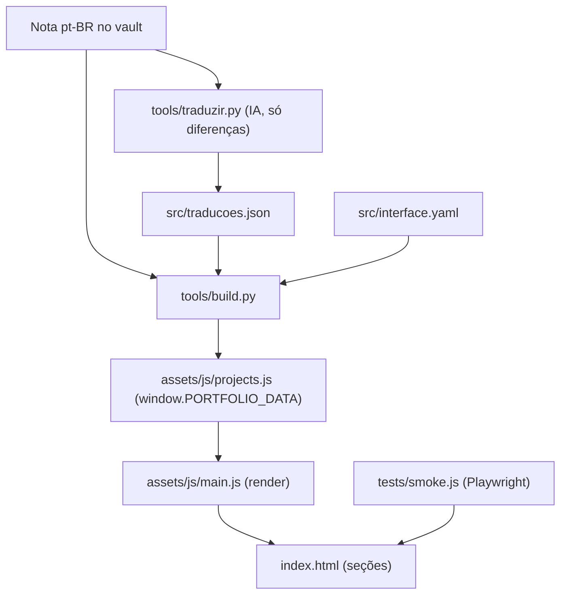

# DESIGN — Portfolio v2 (clean)

## 1. Arquitetura

## 2. Princípios

1. **Mesmo visual do site oficial:** tokens copiados de `quartz-site/quartz.config.yaml` (Schibsted Grotesk, Source Sans 3, IBM Plex Mono; acento roxo `#6d28d9` / `#c084fc`). Mudou lá, muda aqui.
2. **Conteúdo primeiro, largura bem usada:** topbar, sidebar fixa de perfil/contato (estilo AcademicPages) e coluna de conteúdo até 1320px no total; seções lineares.
3. **Sem dependências em produção:** HTML, CSS e JS puros; só Google Fonts de fora.
4. **Acessível:** HTML semântico, `
` nativo, foco visível, `prefers-reduced-motion`, sem rolagem horizontal em 375px.
5. **Charme permitido (v2.1):** céu estrelado só atrás do hero e widget de espectro na Pesquisa, ambos leves e respeitando `prefers-reduced-motion`; foto, números e galeria pessoal.
6. **Mídia sob demanda:** vídeo e iframe só carregam no clique; a página inicial não baixa nenhum dos dois.
7. **Proibido reintroduzir:** 3D, som, intro, HUD, gamificação. A v1 com isso está em `pedroiff0/portfolio-v1-scifi`.
